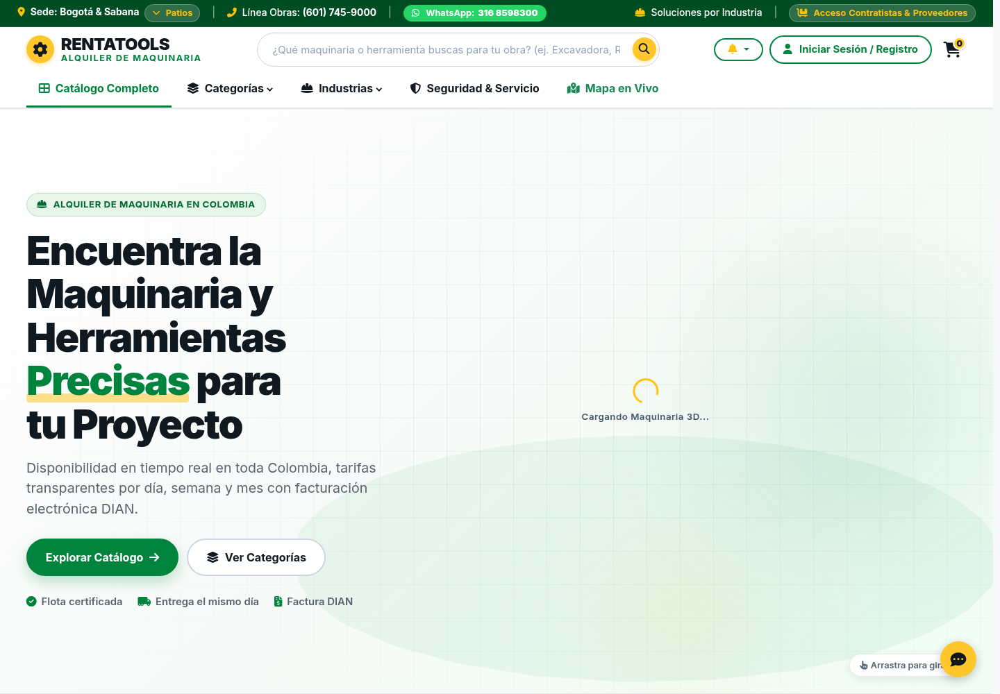
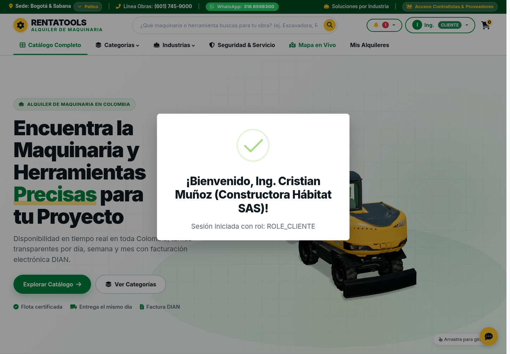
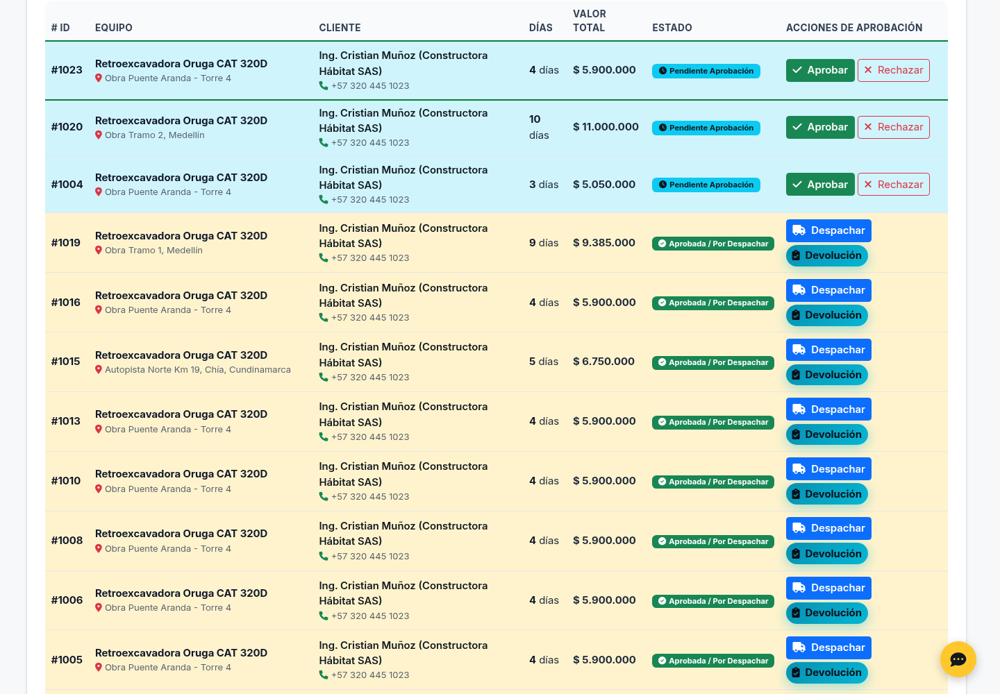
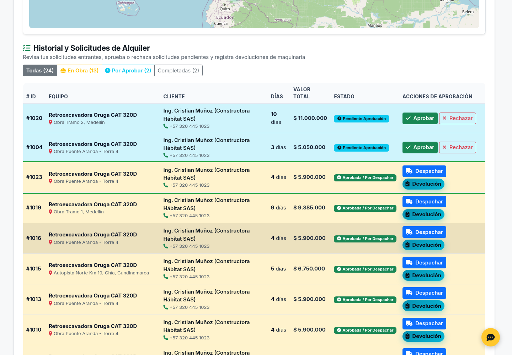
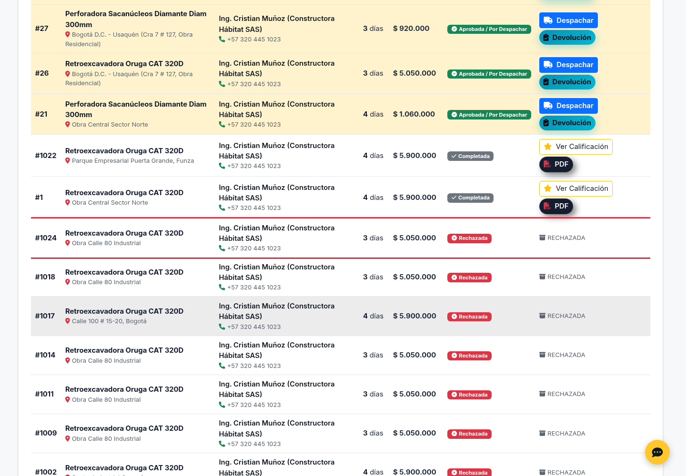
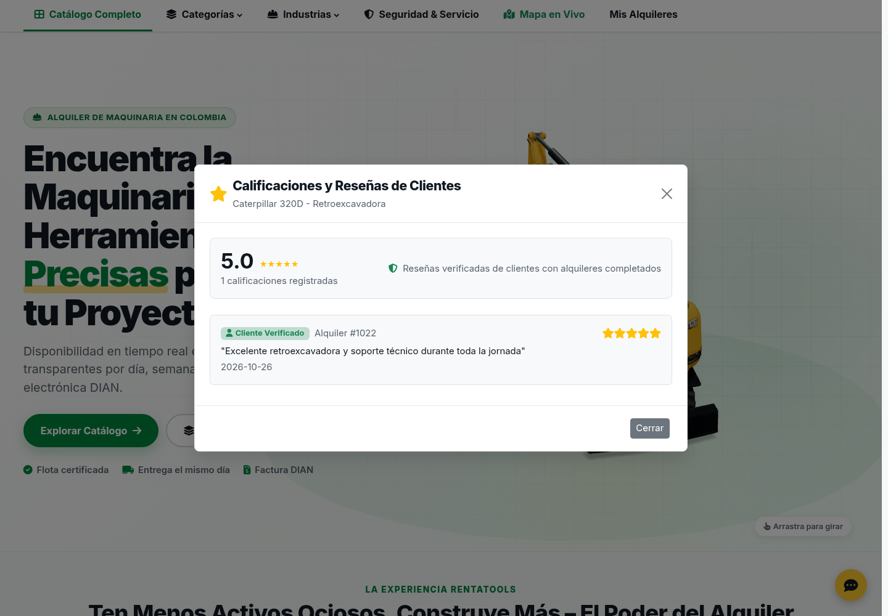

# 🏗️ Plataforma de Renta de Herramientas y Equipos de Construcción (RentaTools)

[](https://www.oracle.com/java/)
[](https://spring.io/projects/spring-boot)
[](https://www.postgresql.org/)
[](https://spring.io/projects/spring-security)
[](https://martinfowler.com/bliki/DomainDrivenDesign.html)
[](https://tomcat.apache.org/)

Plataforma empresarial tipo marketplace B2B/B2C desarrollada en **Spring Boot** para la gestión, reserva, alquiler, inspección física y facturación electrónica de maquinaria pesada y herramientas de construcción (retroexcavadoras, andamios multidireccionales, plantas eléctricas, torres de iluminación, mezcladoras y martillos demoledores).

---

## 📌 Contexto y Objetivos del Proyecto

El alquiler de maquinaria pesada requiere certidumbre en disponibilidad, verificación de condiciones físicas de entrega y trazabilidad en pagos y garantías. 

### 👥 Perfiles de Usuario y Capacidades (RBAC)
* **👑 Administrador (`ROLE_ADMIN`):**
  * Supervisión global del marketplace y control de flota en mapa nacional.
  * Monitoreo de ingresos totales, tasa de ocupación y usuarios registrados.
  * Trazabilidad de alquileres, devoluciones e incidencias de averías.
* **🚜 Proveedor (`ROLE_PROVEEDOR`):**
  * Gestión de catálogo e inventario (alta de maquinaria con fotos y fichas técnicas).
  * Aprobación o rechazo de solicitudes de alquiler.
  * Actas de recepción, inspección técnica y reportes de penalización por daños.
  * Dashboard de ganancias y ocupación de su flota.
* **👷 Cliente (`ROLE_CLIENTE`):**
  * Búsqueda de maquinaria por categoría y proximidad geoespacial a su obra.
  * Carrito de alquiler multi-equipo persistente en la nube (`Cloud Cart`).
  * Validación atómica de fechas sin solapamiento (*Pessimistic Locking*).
  * Pasarela de pago en línea (PSE / Tarjeta) y descarga de factura oficial en PDF.

---

## 🧱 Arquitectura Hexagonal y Estructura Modular

El proyecto implementa **Domain-Driven Design (DDD)** segregado en 3 módulos Maven:

```text
Proyecto_RentaHerramientas/
├── domain/            # Reglas de negocio puras, Value Objects, Agregados y Puertos (Agnóstico de frameworks)
├── application/       # Casos de uso (UseCases), DTOs y orquestación de negocio
├── infrastructure/    # Adaptadores Spring Boot, JPA, Seguridad JWT, WebSockets, OpenPDF y REST
├── frontend/          # Interfaz web responsiva con Bootstrap 5, Three.js (3D) y Leaflet Maps
└── docs/              # Diagrama relacional, colección Postman y scripts SQL (MySQL y PostgreSQL)
```

---

## 🖼️ Diagrama Relacional de la Base de Datos (4FN)

El diseño de la base de datos se encuentra normalizado en **Cuarta Forma Normal (4FN)** con 18 entidades relacionadas:


> Los scripts DDL y las semillas con **más de 20 registros reales por entidad** se encuentran disponibles en:
> * **PostgreSQL:** [`docs/sql/01_schema_4fn.sql`](docs/sql/01_schema_4fn.sql) y [`docs/sql/02_seeds_20_records.sql`](docs/sql/02_seeds_20_records.sql)
> * **MySQL:** [`docs/sql/01_mysql_schema_4fn.sql`](docs/sql/01_mysql_schema_4fn.sql) y [`docs/sql/02_mysql_seeds_20_records.sql`](docs/sql/02_mysql_seeds_20_records.sql)

---

## 🔑 Credenciales Predeterminadas de Prueba

Para probar de inmediato todos los flujos de la plataforma:

| Rol | Usuario | Contraseña | Perfil / Empresa Representada |
|---|---|---|---|
| **Administrador** | `admin` | `Admin123!` | Carlos Mendoza (Director General RentaTools) |
| **Proveedor** | `proveedor` | `Proveedor123!` | Ing. Alejandro Morales (Maquinaria Andina SAS) |
| **Proveedor 2** | `proveedor2` | `Proveedor123!` | Dr. Gabriel Jaramillo (Gecolsa Maquinaria Pesada SAS) |
| **Cliente** | `cliente` | `Cliente123!` | Ing. Cristian Muñoz (Constructora Hábitat SAS) |
| **Cliente 2** | `cliente2` | `Cliente123!` | Ing. Roberto Camargo (Amarilo Construcciones SAS) |

---

## ⚙️ Configuración del Entorno (`application.yml`)

El backend soporta resolución dinámica de base de datos tanto para **PostgreSQL** como para **MySQL**:

```yaml
server:
  port: ${PORT:8080}

spring:
  datasource:
    # URL dinámica (compatible con PostgreSQL local, Supabase o MySQL):
    url: ${SPRING_DATASOURCE_URL:jdbc:postgresql://localhost:5432/renta_herramientas_db}
    username: ${SPRING_DATASOURCE_USERNAME:postgres}
    password: ${SPRING_DATASOURCE_PASSWORD:postgres}
    driver-class-name: ${SPRING_DATASOURCE_DRIVER_CLASS_NAME:org.postgresql.Driver}

  jpa:
    hibernate:
      ddl-auto: update
    properties:
      hibernate:
        format_sql: true

jwt:
  secret: ${JWT_SECRET:RentaToolsUltraSecretSigningKeyMustBeAtLeast256BitsLongForHmacSha256Security!}
  expiration-ms: 86400000 # 24 Horas
```

---

## 🚀 Guía de Instalación y Ejecución Multi-Plataforma

### 1. Clonar el Repositorio
```bash
git clone -b develop https://github.com/Leonardo4516/Proyecto_RentaHerramientas.git
cd Proyecto_RentaHerramientas
```

> [!NOTE]
> **Base de Datos en la Nube (Preconfigurada por defecto):**
> El proyecto viene configurado por defecto para conectarse automáticamente a **Supabase (PostgreSQL en la Nube)**. No necesitas instalar ni configurar PostgreSQL, MySQL ni Docker en tu máquina para correr el proyecto. ¡Solo necesitas **Java 17 o 21** e internet!

### 2. Ejecución Inmediata (Super Sencilla)

El proyecto incluye scripts automatizados que compilan todos los módulos y arrancan el servidor Tomcat integrado de inmediato:

* **En Linux / macOS:**
  ```bash
  ./ejecutar.sh
  ```
* **En Windows (CMD o PowerShell):**
  ```cmd
  ejecutar.bat
  ```

*(El script verifica si el proyecto está compilado; si es la primera vez que se clona, lo compila automáticamente y arranca el servidor en el puerto `8080`).*

---

#### 🛠️ Ejecución Manual en 2 Comandos (Equivalente)

Si prefieres ejecutar los comandos manualmente uno por uno:

1. **Compilar todos los módulos y empaquetar:**
   ```bash
   # Linux / macOS:
   ./mvnw clean package -DskipTests

   # Windows (CMD / PowerShell):
   mvnw.cmd clean package -DskipTests
   ```

2. **Iniciar el servidor Tomcat integrado:**
   ```bash
   # Linux / macOS:
   java -jar infrastructure/target/rentatools.war

   # Windows (CMD / PowerShell):
   java -jar infrastructure\target\rentatools.war
   ```

#### 📦 Método 2: Ejecutar mediante el paquete WAR (`rentatools.war`)

El empaquetado del proyecto genera un archivo WAR híbrido que **incluye su propio servidor Apache Tomcat integrado** en su interior.

> [!IMPORTANT]
> **¿El computador debe tener Tomcat instalado?**
> **¡NO!** No necesitas instalar Apache Tomcat por separado. El archivo `.war` contiene su propio servidor web embebido y arranca inmediatamente con el comando `java -jar`.

**1. Generar el archivo WAR:**
```bash
# Linux / macOS:
./mvnw clean package -DskipTests

# Windows:
mvnw.cmd clean package -DskipTests
```
El archivo compilado quedará ubicado exactamente en:
```text
infrastructure/target/rentatools.war
```

**2. ¿Dónde y cómo ejecutar el comando `java -jar`?**

* **Caso A: Si estás parado en la carpeta raíz del proyecto (`Proyecto_RentaHerramientas`):**
  ```bash
  # Linux / macOS:
  java -jar infrastructure/target/rentatools.war

  # Windows (CMD / PowerShell):
  java -jar infrastructure\target\rentatools.war
  ```

* **Caso B: Si abriste la terminal dentro de la carpeta `infrastructure/target/`:**
  ```bash
  cd infrastructure/target
  java -jar rentatools.war
  ```

* **Caso C: Si copiaste el archivo `rentatools.war` a una USB o al Escritorio de otro computador:**
  Abres la terminal en esa misma carpeta donde pegaste el archivo y ejecutas:
  ```bash
  java -jar rentatools.war
  ```

---

### 3. Acceder a la Aplicación

Una vez que la terminal indique `Tomcat started on port 8080 (http) with context path '/'`:
* 🌐 **Plataforma Web (Frontend):** [http://localhost:8080/](http://localhost:8080/)
* 📚 **Documentación Swagger / OpenAPI:** [http://localhost:8080/swagger-ui.html](http://localhost:8080/swagger-ui.html)
* 🚀 **API REST:** [http://localhost:8080/api/v1/tools](http://localhost:8080/api/v1/tools)

---

## 🛡️ Guía de Portabilidad, Respaldo Autónomo H2 y Ejecución en PC Ajeno (Laboratorio / Evaluador)

Esta sección garantiza que **RentaTools** funcione al 100% en cualquier computador de evaluación o laboratorio (Windows, Linux, macOS) sin requerir configuraciones complejas, sin depender de bases de datos preinstaladas y resolviendo automáticamente conflictos de puertos.

---

### 1. ⚡ Respaldo Autónomo H2 en Memoria (Zero-Config / Offline)

¿Qué pasa si el computador del evaluador **no tiene PostgreSQL instalado**, el servicio está apagado, o la contraseña local de `postgres` es diferente?

* **Detección Automática:** Los scripts inteligentes `ejecutar.sh` y `ejecutar.bat` prueban la conectividad contra los puertos 5434 y 5432. Si PostgreSQL o Docker no responden o rechazan las credenciales, el sistema activa automáticamente el **Modo de Respaldo H2 In-Memory**.
* **Ejecución Forzada Manual:** Puedes forzar el modo autónomo H2 en cualquier momento ejecutando:
  * **Linux / macOS:** `./ejecutar.sh --h2`
  * **Windows:** `ejecutar.bat --h2`
* **Auto-Población de Datos:** Al iniciar en H2, Hibernate genera automáticamente la estructura completa de tablas y la aplicación precarga de inmediato el catálogo de **25 maquinarias pesadas**, categorías, imágenes, especificaciones y los usuarios semilla (`admin`, `proveedor`, `cliente`, etc.). ¡El sistema queda 100% operativo sin tocar una sola línea de comandos SQL!

---

### 2. 🔍 Acceso a la Consola Web H2 (`/h2-console`) y Evidencia para el Examen

Si el evaluador te solicita abrir la base de datos o necesitas tomar capturas de las tablas pobladas:

1. Abre en tu navegador: **`http://localhost:<PORT>/h2-console`** *(reemplaza `<PORT>` por el puerto en el que arrancó el sistema, e.g., 8080 o 8081)*.
2. En la pantalla de inicio de sesión de H2 Console, ingresa los siguientes parámetros exactos:

| Campo en H2 Console | Valor Requerido | Nota Crítica |
|---|---|---|
| **Saved Settings** | `Generic H2 (Embedded)` | Seleccionar del menú desplegable |
| **Driver Class** | `org.h2.Driver` | Viene por defecto |
| **JDBC URL** | `jdbc:h2:mem:rentatools` | ⚠️ **Borrar `jdbc:h2:~/test`** y colocar exactamente `jdbc:h2:mem:rentatools` |
| **User Name** | `sa` | Usuario administrador en minúsculas |
| **Password** | *(dejar en blanco)* | No escribir nada, dejar la caja vacía |

3. Haz clic en el botón **Connect**.
4. **Consultas SQL recomendadas para la captura del examen:**
   * **Ver catálogo de herramientas cargadas:**
     ```sql
     SELECT id, code, name, brand, model, daily_price, deposit_amount, status FROM tools ORDER BY id ASC;
     ```
   * **Ver usuarios y roles registrados:**
     ```sql
     SELECT id, username, email, full_name, role, active FROM users;
     ```
   * **Ver proveedores registrados con calificaciones:**
     ```sql
     SELECT p.id, u.full_name, p.company_name, p.city, p.rating, p.verified FROM providers p JOIN users u ON p.user_id = u.id;
     ```
   * **Ver facturas emitidas:**
     ```sql
     SELECT id, invoice_number, client_name, total_amount, deposit_amount, issue_date FROM invoices;
     ```

---

### 3. 🐘 Conectar DBeaver a la Base de Datos H2 en Memoria (Puerto TCP 9092)

Si el evaluador **exige** inspeccionar la base de datos a través de una herramienta de escritorio externa como **DBeaver**, **IntelliJ Database Tools** o **DataGrip**:

> [!TIP]
> Normalmente una base de datos en memoria (`mem:rentatools`) es inaccesible fuera de su propio proceso Java. Para solucionar esto, **RentaTools inicia automáticamente un servidor H2 TCP en el puerto 9092**, permitiendo que clientes de escritorio externos se conecten transparentemente a la memoria de la aplicación.

**Pasos de conexión en DBeaver:**
1. En DBeaver, haz clic en **Nueva Conexión** (icono de enchufe con signo `+`).
2. Selecciona **H2 GIS** o **H2 Embedded / Server** y pulsa *Siguiente*.
3. En la pestaña de configuración:
   * **Tipo de Conexión / Connect by:** Selecciona `URL` (o `Server`).
   * **JDBC URL:**
     ```text
     jdbc:h2:tcp://localhost:9092/mem:rentatools
     ```
   * **Username:** `sa`
   * **Password:** *(dejar completamente vacío)*
4. Haz clic en **Test Connection ...** (DBeaver descargará el driver H2 automáticamente si no lo tiene).
5. Pulsa **Finalizar** y podrás explorar todas las tablas, esquemas y relaciones en tiempo real.

---

### 4. 🔀 Resolución Automática de Conflictos de Puertos (Puerto 8080 Ocupado)

En computadores de laboratorio o servidores compartidos, el puerto `8080` frecuentemente está ocupado por otros servicios (Oracle, Apache Tomcat, Jenkins, IIS, otro backend).

* **Comportamiento del Script:** `ejecutar.sh` y `ejecutar.bat` escanean los puertos de forma incremental (`8080`, `8081`, `8082`, etc.) y asignan automáticamente el primer puerto libre disponible.
* **Banner de Terminal:** Al arrancar, el script imprime claramente en pantalla el puerto asignado:
  ```text
  ==========================================================
  🚀 Iniciando RentaTools en puerto 8081
  🗄️  Base de Datos:      H2 In-Memory (Modo Respaldo Autónomo)
  👉 Abre en tu navegador: http://localhost:8081/
  👉 Swagger UI:          http://localhost:8081/swagger-ui.html
  👉 Consola Web H2:      http://localhost:8081/h2-console
     * JDBC URL:          jdbc:h2:mem:rentatools
     * Usuario:           sa  |  Contraseña: (vacía)
  👉 Conexión DBeaver:    jdbc:h2:tcp://localhost:9092/mem:rentatools
  ==========================================================
  ```
* **Ajuste en Postman y Frontend:**
  * Si el puerto seleccionado fue el `8081`, abre tu navegador en: `http://localhost:8081/`.
  * En **Postman**, ve a la colección `RentaTools` -> Pestaña **Variables** -> Cambia el valor actual de `baseUrl` a `http://localhost:8081`.
  * **CORS:** La configuración de seguridad ya tiene habilitados los orígenes `http://localhost:8080`, `http://localhost:8081`, `http://localhost:8085` y `http://127.0.0.1:5500`.

---

### 5. 🐧 Permisos y Compatibilidad de Sistema Operativo (Linux vs Windows)

#### En Linux / macOS:
* Si clonaste o descomprimiste el proyecto desde una memoria USB o archivo ZIP, los scripts pueden carecer de permisos de ejecución:
  ```bash
  chmod +x mvnw ejecutar.sh
  ```
* Si el archivo fue editado en Windows y Linux reporta error de fin de línea `\r: command not found`:
  ```bash
  sed -i 's/\r$//' ejecutar.sh mvnw
  ```
* Ejecución:
  ```bash
  ./ejecutar.sh
  ```

#### En Windows (CMD o PowerShell):
* Ejecutar directamente el archivo por lotes desde la raíz del proyecto:
  ```cmd
  ejecutar.bat
  ```
  *(O en PowerShell: `.\ejecutar.bat`)*

---

### 6. ✅ Checklist Paso a Paso para la Sustentación / Examen Técnico

Sigue este checklist secuencial para garantizar cero errores durante tu presentación:

- [ ] **1. Verificar versión de Java en el equipo:**
  Ejecuta `java -version`. Debe ser Java 17 o Java 21 (LTS).
- [ ] **2. Otorgar permisos (solo Linux / macOS):**
  Ejecuta `chmod +x mvnw ejecutar.sh`.
- [ ] **3. Iniciar la aplicación:**
  Ejecuta `./ejecutar.sh` (Linux) o `ejecutar.bat` (Windows). Si no deseas depender de bases de datos locales, añade `--h2`.
- [ ] **4. Anotar el puerto asignado:**
  Revisa la consola: si indicó puerto `8080`, navega en `http://localhost:8080/`; si indicó `8081`, navega en `http://localhost:8081/`.
- [ ] **5. Validar la interfaz gráfica web:**
  Abre la URL base en el navegador y verifica que el catálogo cargue las retroexcavadoras, plantas eléctricas y filtros de búsqueda.
- [ ] **6. Iniciar sesión de prueba:**
  Usa `admin` / `Admin123!` para el panel administrativo, o `cliente` / `Cliente123!` para realizar una reserva.
- [ ] **7. Si el evaluador solicita evidencia de base de datos:**
  - **Vía Web:** Abre `http://localhost:<PORT>/h2-console`, coloca `jdbc:h2:mem:rentatools`, usuario `sa`, contraseña vacía, y corre `SELECT count(*) FROM tools;` (debe mostrar 25).
  - **Vía DBeaver:** Conéctate a `jdbc:h2:tcp://localhost:9092/mem:rentatools`.
- [ ] **8. Si el evaluador solicita pruebas con Postman:**
  Asegúrate de que la variable `baseUrl` coincida con el puerto activo antes de ejecutar los requests.

---

## 💾 Opciones de Base de Datos Local (Opcional)

Si en lugar de la base de datos en la nube de Supabase deseas trabajar con una base de datos local:

* **Opción A (Docker Compose - PostgreSQL 16):**
  ```bash
  docker compose up -d
  ```
* **Opción B (MySQL Local):**
  Crea la base de datos `renta_herramientas_db` en tu servidor MySQL 8 y ejecuta los scripts:
  ```bash
  mysql -u root -p < docs/sql/01_mysql_schema_4fn.sql
  mysql -u root -p < docs/sql/02_mysql_seeds_20_records.sql
  ```
  Y arranca pasando las variables de conexión local (`-DSPRING_DATASOURCE_URL=...`).

---

## 🚢 Despliegue en Servidor Apache Tomcat Externo (Solo si es exigido por el evaluador)

Si el profesor o evaluador te exige desplegar la aplicación dentro de una instalación independiente de Apache Tomcat:

1. Asegúrate de tener instalado **Apache Tomcat 10.1 o superior** (compatible con Jakarta EE 10 / Servlet 6.0).
2. Genera el empaquetado:
   ```bash
   ./mvnw clean package -DskipTests
   ```
3. Copia el archivo `infrastructure/target/rentatools.war` dentro de la carpeta `webapps/` de Apache Tomcat:
   ```bash
   # En Linux / macOS:
   cp infrastructure/target/rentatools.war /opt/tomcat/webapps/rentatools.war

   # En Windows:
   copy infrastructure\target\rentatools.war C:\apache-tomcat-10.1.x\webapps\rentatools.war
   ```
4. Inicia Tomcat (`bin/startup.sh` en Linux o `bin/startup.bat` en Windows).
5. Accede en tu navegador a: [http://localhost:8080/rentatools/](http://localhost:8080/rentatools/)

---

## 🧪 Pruebas Unitarias y de Integración

Para ejecutar la suite completa de pruebas automatizadas:

```bash
# Linux / macOS:
./mvnw test

# Windows:
mvnw.cmd test
```

> **Resultado:** 16 pruebas unitarias y de concurrencia ejecutadas con éxito (`0 Failures, 0 Errors, BUILD SUCCESS`) validando:
> * Autenticación y generación de JWT.
> * Algoritmo de detección de solapamiento de fechas.
> * Prevención de condiciones de carrera en reservas simultáneas.
> * Cálculo de impuestos y generación de PDFs con OpenPDF.
> * Búsqueda geoespacial Haversine.

---

## 📬 Pruebas de API con Postman

Se incluye la colección oficial con todas las peticiones organizadas por carpetas y variables dinámicas de autenticación:

* **Archivo de Colección:** [`docs/postman/RentaTools.postman_collection.json`](docs/postman/RentaTools.postman_collection.json)

### Pasos para usarla:
1. Abre Postman y haz clic en **Import**.
2. Selecciona el archivo `docs/postman/RentaTools.postman_collection.json`.
3. Ejecuta la petición **"Login Administrador"** o **"Login Cliente"** dentro de la carpeta *1. Autenticación*. El token JWT se guardará automáticamente en las variables del entorno para autorizar todas las demás consultas.

---

## 📑 Catálogo de Endpoints de la API REST

| Módulo | Método | Endpoint | Descripción | Acceso |
|---|---|---|---|---|
| **Auth** | `POST` | `/api/v1/auth/login` | Autenticación y obtención de JWT | Público |
| **Auth** | `POST` | `/api/v1/auth/register` | Registro de cliente o proveedor | Público |
| **Auth** | `GET` | `/api/v1/auth/me` | Información del perfil autenticado | Autenticado |
| **Herramientas** | `GET` | `/api/v1/tools` | Catálogo de maquinaria (filtros por categoría y estado) | Público |
| **Herramientas** | `GET` | `/api/v1/tools/{id}` | Detalle de herramienta y especificaciones | Público |
| **Herramientas** | `GET` | `/api/v1/tools/nearby` | Búsqueda geoespacial por radio (`lat`, `lng`, `radiusKm`) | Público |
| **Reservas (Examen)** | `POST` | `/api/reservas/{id}/aprobar` | Aprobar reserva pendiente validando disponibilidad | Proveedor / Admin |
| **Reservas (Examen)** | `POST` | `/api/reservas/{id}/rechazar` | Rechazar reserva pendiente con motivo opcional | Proveedor / Admin |
| **Reservas (Alias)** | `POST` | `/api/reservas/{id}/cancelar` | Cancelar reserva (alias) | Cliente / Proveedor |
| **Reservas (Alias)** | `POST` | `/api/reservas/{id}/devolver` | Registrar devolución e inspección (alias) | Proveedor / Admin |
| **Reservas (Alias)** | `POST` | `/api/reservas/{id}/calificar` | Calificar reserva completada de 1 a 5 estrellas | Cliente |
| **Reservas (Alias)** | `GET` | `/api/reservas/{id}/calificacion` | Consultar calificación de la reserva | Autenticado |
| **Reservas** | `GET` | `/api/v1/rentals` | Listado general de alquileres | Autenticado |
| **Reservas** | `GET` | `/api/v1/rentals/my-rentals` | Alquileres del usuario en sesión | Cliente / Proveedor |
| **Reservas** | `GET` | `/api/v1/rentals/check-availability` | Comprobar disponibilidad en rango de fechas | Público |
| **Reservas** | `POST` | `/api/v1/rentals` | Crear solicitud de alquiler | Cliente |
| **Reservas** | `PUT` | `/api/v1/rentals/{id}/status` | Confirmar o rechazar alquiler | Proveedor / Admin |
| **Reservas** | `POST` | `/api/v1/rentals/{id}/return` | Registrar devolución, inspección y daños | Proveedor / Admin |
| **Reservas** | `GET` | `/api/v1/rentals/{id}/timeline` | Timeline de auditoría de estados de la reserva | Autenticado |
| **Comercial** | `GET` | `/api/v1/coupons/validate` | Validar cupón de descuento promocional | Público |
| **Comercial** | `POST` | `/api/v1/reviews` | Crear reseña y calificación técnica | Cliente / Admin |
| **Comercial** | `GET` | `/api/v1/reviews/tool/{toolId}` | Listar reseñas técnicas de una herramienta | Público |
| **Herramientas (Alias)** | `PUT` | `/api/herramientas/{id}/mantenimiento` | Enviar maquinaria a mantenimiento técnico | Proveedor / Admin |
| **Herramientas (Alias)** | `PUT` | `/api/herramientas/{id}/operativa` | Retornar maquinaria a estado operativa | Proveedor / Admin |
| **Carrito** | `GET` | `/api/v1/cart` | Obtener ítems del carrito en la nube | Cliente |
| **Carrito** | `POST` | `/api/v1/cart/items` | Agregar maquinaria al carrito | Cliente |
| **Carrito** | `DELETE`| `/api/v1/cart/items/{toolId}` | Eliminar ítem del carrito | Cliente |
| **Facturas** | `POST` | `/api/v1/invoices` | Generar factura electrónica con IVA 19% | Autenticado |
| **Facturas** | `GET` | `/api/v1/invoices/{id}` | Consultar factura por ID | Autenticado |
| **Facturas** | `GET` | `/api/v1/invoices/{id}/pdf` | Descargar factura oficial en PDF | Autenticado |
| **Pagos** | `POST` | `/api/v1/payments` | Procesar pago en línea (PSE / Tarjeta) | Cliente |
| **Reportes** | `GET` | `/api/v1/reports/dashboard` | Métricas globales de ingresos y ocupación | Admin / Proveedor |
| **Reportes** | `GET` | `/api/v1/reports/provider/{id}` | Estadísticas de facturación por proveedor | Proveedor / Admin |

---

### Ejemplo de Petición JSON: Crear Alquiler (`POST /api/v1/rentals`)
```json
{
  "toolId": 1,
  "startDate": "2026-11-10",
  "endDate": "2026-11-15",
  "deliveryAddress": "Proyecto Torre Titanium - Calle 100 # 15-20, Bogotá",
  "notes": "Requerida con operador certificado"
}
```

### Ejemplo de Respuesta JSON (`201 Created`):
```json
{
  "id": 26,
  "clientId": 1,
  "clientName": "Constructora Hábitat SAS",
  "toolId": 1,
  "toolName": "Retroexcavadora Oruga CAT 320D",
  "startDate": "2026-11-10",
  "endDate": "2026-11-15",
  "totalDays": 5,
  "dailyRate": 850000.00,
  "depositAmount": 2500000.00,
  "subtotal": 4250000.00,
  "status": "PENDIENTE",
  "deliveryAddress": "Proyecto Torre Titanium - Calle 100 # 15-20, Bogotá"
}
```

---

## 🌐 Swagger y Documentación Interactiva OpenAPI
Una vez iniciada la aplicación, puedes interactuar directamente con todos los endpoints en:
* **Interfaz Swagger UI:** [http://localhost:8080/swagger-ui.html](http://localhost:8080/swagger-ui.html)
* **Contrato OpenAPI v3:** [http://localhost:8080/v3/api-docs](http://localhost:8080/v3/api-docs)

---

## 💻 Documentación Adicional

* [**Arquitectura DDD y Patrones de Concurrencia**](docs/ARCHITECTURE_DDD.md)
* [**Diseño y Normalización de Base de Datos en 4FN**](docs/DATABASE_SETUP_4FN.md)
* [**Seguridad JWT, Roles y Matriz de Acceso**](docs/JWT_SECURITY_ROLES.md)
* [**Contratos de la API REST y Swagger**](docs/SWAGGER_API_CONTRACTS.md)
* [**Colección Oficial de Postman**](docs/postman/RentaTools.postman_collection.json)

---

## 🎯 Guía Maestra para la Evaluación Técnica (Examen de Gestión de Reservas)

### 1. Enunciado y Requerimiento Clave
> **Objetivo:** Implementar la lógica de negocio que permite a un Proveedor aceptar o rechazar las solicitudes de alquiler pendientes, cumpliendo con la funcionalidad clave del proyecto.
> 
> **Instrucciones Técnicas:**
> 1. **Modificar Entidad Reserva:** Asegurarse de que `RentalBooking` tenga el enum `BookingStatus` con los estados `PENDIENTE`, `APROBADA` y `RECHAZADA`. Por defecto, una reserva creada inicia en `PENDIENTE`.
> 2. **Lógica en Servicio (`ReservaService`):**
>    - `aprobarReserva(Long idReserva)`: Buscar la reserva, verificar que esté en `PENDIENTE`, validar disponibilidad (si no hay, lanzar `HerramientaNoDisponibleException`) y cambiar el estado a `APROBADA`.
>    - `rechazarReserva(Long idReserva, String motivo)`: Buscar la reserva, verificar que esté en `PENDIENTE` y cambiar el estado a `RECHAZADA`.
> 3. **Controladores REST:**
>    - `POST /api/reservas/{id}/aprobar` (Rol: Proveedor / Admin).
>    - `POST /api/reservas/{id}/rechazar` (Rol: Proveedor / Admin).

---

### 2. Arquitectura de la Solución Implementada

```
                                  PETICIÓN REST (HTTP)
                                          │
            ┌─────────────────────────────┴─────────────────────────────┐
            ▼                                                           ▼
POST /api/reservas/{id}/aprobar                             POST /api/reservas/{id}/rechazar
    [ReservaController]                                         [ReservaController]
            │                                                           │
            ▼                                                           ▼
ReservaService.aprobarReserva(id)                           ReservaService.rechazarReserva(id, motivo)
            │                                                           │
    ┌───────┴──────────────────────────┐                                │
    ▼                                  ▼                                ▼
¿Está PENDIENTE?              ¿Herramienta disponible?            ¿Está PENDIENTE?
  NO ➜ 409 Conflict              NO ➜ 409 Conflict                  NO ➜ 409 Conflict
  SI ➜ booking.approve()         (HerramientaNoDisponible)          SI ➜ booking.reject()
            │                                                           │
            ▼                                                           ▼
RentalRepository.save(APROBADA)                             RentalRepository.save(RECHAZADA)
            │                                                           │
            ▼                                                           ▼
PostgreSQL / H2: status='APROBADA'                          PostgreSQL / H2: status='RECHAZADA'
```

---

### 3. Evidencias de Ejecución en Navegador Web (Playwright Chromium)

Las pruebas manuales y automatizadas fueron ejecutadas sobre la interfaz web en vivo en `http://localhost:8080/`:

#### A. Catálogo General y Portal Principal


#### B. Sesión Autenticada de Cliente


#### C. Bandeja de Solicitudes Pendientes del Proveedor (Botones de Acción)


#### D. Reserva Aprobada en Vivo (`POST /api/reservas/{id}/aprobar` ➜ Status: `APROBADA`)


#### E. Reserva Rechazada en Vivo (`POST /api/reservas/{id}/rechazar` ➜ Status: `RECHAZADA`)


#### F. Modal de Reseñas y Calificaciones Técnicas


---

### 4. Guía Rápida de Comandos para Sustentación con Postman y SQL

#### Paso 1: Autenticarse como Proveedor
```bash
curl -X POST "http://localhost:8080/api/v1/auth/login" \
  -H "Content-Type: application/json" \
  -d '{"usernameOrEmail":"proveedor","password":"Proveedor123!"}'
```
*Copia el token JWT retornado.*

#### Paso 2: Aprobar una Reserva
```bash
curl -X POST "http://localhost:8080/api/reservas/1015/aprobar" \
  -H "Authorization: Bearer <TOKEN_PROVEEDOR>"
```
*Respuesta esperada:* `200 OK` con `"status": "APROBADA"`.

#### Paso 3: Rechazar una Reserva
```bash
curl -X POST "http://localhost:8080/api/reservas/1017/rechazar?motivo=Mantenimiento+preventivo" \
  -H "Authorization: Bearer <TOKEN_PROVEEDOR>"
```
*Respuesta esperada:* `200 OK` con `"status": "RECHAZADA"`.

#### Paso 4: Validación en Base de Datos (PostgreSQL o H2 Console)
```sql
SELECT id, client_id, tool_id, start_date, end_date, status, notes
FROM rentals
WHERE id IN (1015, 1017)
ORDER BY id ASC;
```
