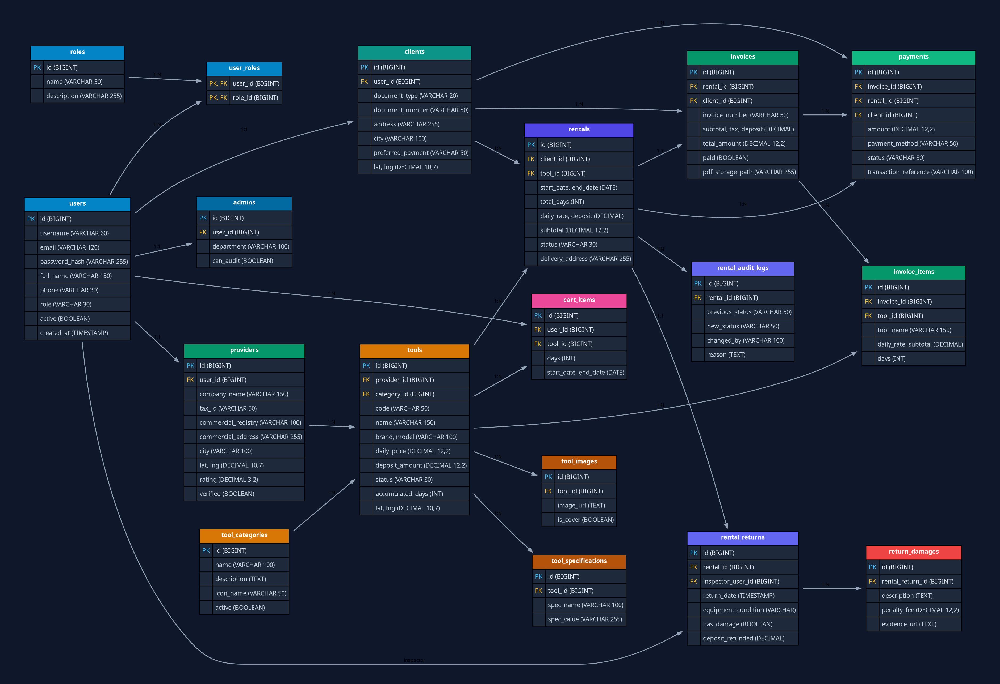

# 🗄️ Esquema de Base de Datos y Normalización en 4FN

La base de datos de **RentaTools** ha sido diseñada cumpliendo rigurosamente la **Cuarta Forma Normal (4FN)**, eliminando anomalías de redundancia, dependencias transitivas y dependencias multivaluadas.

---

## 🖼️ Diagrama Entidad-Relación

---

## 📊 Las 18 Tablas del Sistema

| # | Tabla | Descripción | Clave Primaria | Relaciones Foráneas |
|---|---|---|---|---|
| 1 | `roles` | Catálogo de roles RBAC | `id` | - |
| 2 | `users` | Credenciales e identidad común | `id` | - |
| 3 | `user_roles` | Asociación muchos a muchos | `(user_id, role_id)` | `users`, `roles` |
| 4 | `admins` | Perfil extendido del administrador | `id` | `users` |
| 5 | `providers` | Perfil extendido del proveedor con geolocalización | `id` | `users` |
| 6 | `clients` | Perfil extendido del cliente / constructora | `id` | `users` |
| 7 | `tool_categories` | Catálogo de tipos de maquinaria | `id` | - |
| 8 | `tools` | Inventario de equipos, tarifas y coordenadas | `id` | `providers`, `tool_categories` |
| 9 | `tool_images` | Rutas de fotografías y portadas | `id` | `tools` |
| 10 | `tool_specifications` | Fichas técnicas (clave-valor) | `id` | `tools` |
| 11 | `rentals` | Contratos de alquiler y reservas | `id` | `clients`, `tools` |
| 12 | `rental_returns` | Actas de devolución física e inspección | `id` | `rentals`, `users` |
| 13 | `return_damages` | Reportes de daños y penalizaciones | `id` | `rental_returns` |
| 14 | `invoices` | Facturas electrónicas con desglose fiscal | `id` | `rentals`, `clients` |
| 15 | `invoice_items` | Ítems individuales facturados | `id` | `invoices`, `tools` |
| 16 | `payments` | Comprobantes y transacciones de pago | `id` | `invoices`, `rentals`, `clients` |
| 17 | `rental_audit_logs` | Trazabilidad cronológica de estados | `id` | `rentals` |
| 18 | `cart_items` | Carrito persistente multi-dispositivo | `id` | `users`, `tools` |

---

## ⚙️ Soporte Dual: PostgreSQL y MySQL

El proyecto cuenta con scripts oficiales probados para ambos motores en `docs/sql/`:
* **PostgreSQL 16:**
  * `01_schema_4fn.sql` (DDL de tablas e índices)
  * `02_seeds_20_records.sql` (Más de 20 registros reales por entidad)
  * `03_rental_audit_timeline.sql` (Auditoría cronológica)
* **MySQL 8.0+:**
  * `01_mysql_schema_4fn.sql` (DDL con sintaxis MySQL)
  * `02_mysql_seeds_20_records.sql` (Semillas con sintaxis `ON DUPLICATE KEY UPDATE`)
